# Số hóa Lưu trữ

Phần mềm giúp **số hóa hồ sơ lưu trữ** trên máy tính của bạn:

1. Bạn đưa vào **file PDF scan** của một hồ sơ.
2. Phần mềm **đọc chữ** trên từng trang (OCR) và dùng **AI** để điền thông tin từng tài liệu: tên loại,
   số, ký hiệu, ngày ban hành, cơ quan ban hành, trích yếu, từ khóa…
3. Bạn **xem lại, sửa** nếu cần, rồi **xuất file Excel** gồm đúng **23 cột** theo
   **điểm c khoản 1 Điều 4 Thông tư 05/2025/TT-BNV**.

> 🔒 **Chạy hoàn toàn trên máy của bạn, không cần Internet khi dùng.** Tài liệu (kể cả tài liệu mật)
> không bao giờ bị gửi ra ngoài. Chỉ lần **cài đặt đầu tiên** mới cần mạng để tải phần mềm và model.

---

## Mục lục

1. [Máy cần gì](#1-máy-cần-gì)
2. [Cài đặt (làm một lần)](#2-cài-đặt-làm-một-lần)
3. [Mở phần mềm](#3-mở-phần-mềm)
4. [Số hóa một hồ sơ — từng bước](#4-số-hóa-một-hồ-sơ--từng-bước)
5. [File Excel xuất ra có gì](#5-file-excel-xuất-ra-có-gì)
6. [Các việc khác](#6-các-việc-khác)
7. [Gặp lỗi thì làm gì](#7-gặp-lỗi-thì-làm-gì)
8. [Cập nhật lên bản mới](#8-cập-nhật-lên-bản-mới)

---

## 1. Máy cần gì

| | Tối thiểu | Nên có |
|---|---|---|
| Hệ điều hành | Windows 10 hoặc 11 (64-bit) | Windows 11 |
| RAM | 16 GB | **32 GB** |
| Ổ cứng trống | 25 GB | 40 GB |
| Mạng Internet | chỉ cần **lúc cài đặt** | |

Máy có **card đồ họa NVIDIA** sẽ chạy nhanh hơn nhiều — phần mềm tự nhận ra và dùng.

---

## 2. Cài đặt (làm một lần)

### Bước 2.1 — Tải phần mềm về máy

1. Mở trang <https://github.com/jerrynguy/personal_OCR>.
2. Bấm nút xanh **`<> Code`** → chọn **Download ZIP**.
3. Mở file ZIP vừa tải (thường ở thư mục **Downloads**) → bấm **Extract all** (Giải nén tất cả) →
   chọn chỗ lưu, ví dụ `D:\Projects` → **Extract**.

Bạn sẽ có một thư mục, ví dụ `D:\Projects\personal_OCR-main`, bên trong có các file
**`cai-dat.bat`** và **`mo-app.bat`**.

> Nên để thư mục ở ổ **D:** (hoặc ổ có nhiều chỗ trống), **không** để trong Desktop hay OneDrive.

### Bước 2.2 — Bấm đúp `cai-dat.bat`

Trong thư mục vừa giải nén, **bấm đúp vào `cai-dat.bat`**. Một cửa sổ đen hiện ra và tự làm hết
7 bước (cài thư viện, tải model đọc chữ, tải AI…). **Cứ để nó chạy**, lần đầu mất khoảng
**30–60 phút** tùy mạng. Khi thấy chữ xanh **`CÀI ĐẶT XONG!`** là xong.

Có thể gặp các tình huống sau — đều bình thường:

| Thấy gì | Làm gì |
|---|---|
| Khung xanh **"Windows protected your PC"** | Bấm **More info** → **Run anyway** |
| Cửa sổ báo **"Đã cài xong phần mềm cần thiết… bấm đúp LẠI cai-dat.bat"** | Máy chưa có Python/Node.js, phần mềm vừa tự cài. **Đóng** cửa sổ, **bấm đúp lại** `cai-dat.bat` |
| Windows hỏi **"Do you want to allow this app to make changes…"** | Bấm **Yes** |
| Bước 6 tải **model AI 12 GB** rất lâu | Bình thường, cứ chờ. Đã có model ở máy khác thì xem [Đổi model AI](#đổi-model-ai) |

> Nếu đã có model `gpt-oss-20b-MXFP4.gguf` (vd. tải bằng LM Studio), có thể bấm đóng cửa sổ khi
> đến bước 6, mở phần mềm rồi chọn file đó ở mục **Model AI**, sau đó chạy lại `cai-dat.bat` để
> làm nốt bước 7.

---

## 3. Mở phần mềm

1. **Cắm sạc** cho laptop (chạy bằng pin, máy tự giảm tốc độ — xử lý sẽ chậm hơn rất nhiều).
2. **Bấm đúp `mo-app.bat`**.
3. Một **cửa sổ đen** hiện ra, rồi **trình duyệt tự mở** phần mềm.

- **Đừng đóng cửa sổ đen** khi đang dùng — đóng nó là phần mềm tắt.
- Lần đầu mở, chờ khoảng **30–60 giây** cho đến khi **góc phải trên cùng** hiện
  **`OCR: sẵn sàng`** và **`AI: sẵn sàng`** (chữ xanh) như ảnh dưới — lúc đó phần mềm đã sẵn sàng:

- Dùng xong: **đóng cửa sổ đen**.

---

## 4. Số hóa một hồ sơ — từng bước

### Bước 1 — Đưa file PDF vào

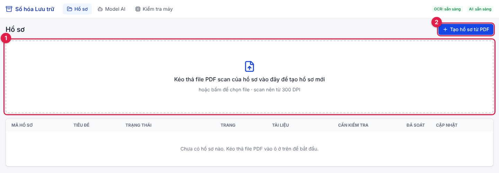

| Số | Ý nghĩa |
|---|---|
| ① | **Kéo file PDF** từ thư mục thả vào ô này (hoặc bấm vào ô để chọn file) |
| ② | Hoặc bấm nút này để chọn file PDF |

### Bước 2 — Đặt mã hồ sơ

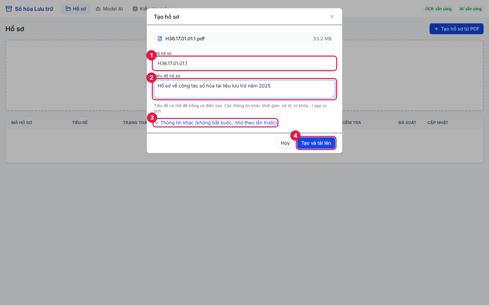

| Số | Ý nghĩa |
|---|---|
| ① | **Mã hồ sơ** — phần mềm lấy sẵn từ tên file, sửa nếu cần |
| ② | **Tiêu đề hồ sơ** — không bắt buộc, có thể điền sau |
| ③ | **Thông tin khác** — thời hạn lưu trữ, mức độ tiếp cận, phông… (không bắt buộc) |
| ④ | Bấm **Tạo và tải lên** |

Bấm ③ sẽ hiện thêm các ô dưới đây. Chỉ cần điền **một lần** — lần sau phần mềm **tự nhớ**:

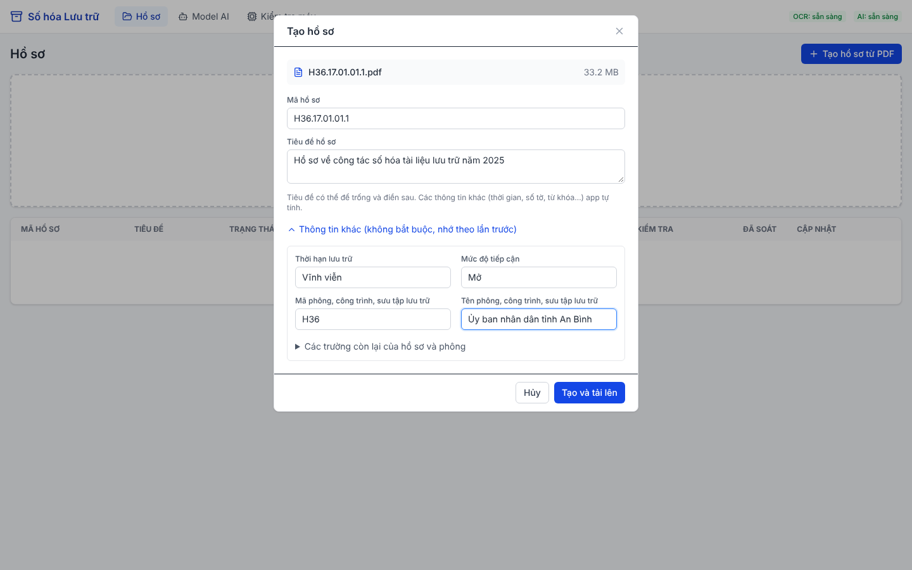

> Các thông tin này **không in trên văn bản** nên không phần mềm nào đọc được — bạn điền một lần
> cho cả hồ sơ, phần mềm tự điền xuống mọi tài liệu trong hồ sơ.

### Bước 3 — Tách tài liệu

Phần mềm hiện ảnh nhỏ của từng trang. **Bấm vào trang đầu của mỗi tài liệu** để đánh dấu (viền xanh):

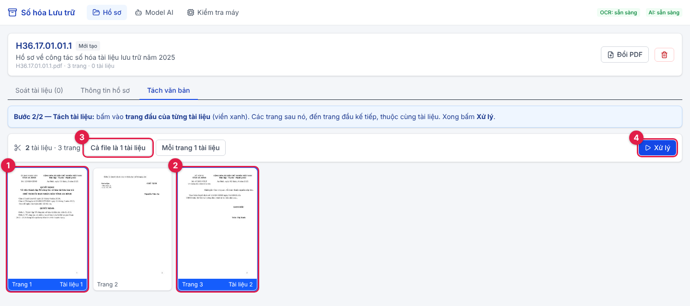

| Số | Ý nghĩa |
|---|---|
| ① | Trang 1 luôn là đầu **tài liệu 1** |
| ② | Bấm vào trang 3 → trang 3 thành đầu **tài liệu 2**. Trang 2 (không viền) thuộc tài liệu 1 |
| ③ | **Cả file là 1 tài liệu** — chọn khi file PDF chỉ chứa một tài liệu (thường gặp nhất) |
| ④ | Bấm **Xử lý** khi đã đánh dấu xong |

> 💡 Nếu tài liệu đã được chia sẵn mỗi file một tài liệu, chỉ cần để mặc định **Cả file là 1 tài
> liệu** rồi bấm **Xử lý**.

### Bước 4 — Chờ phần mềm đọc

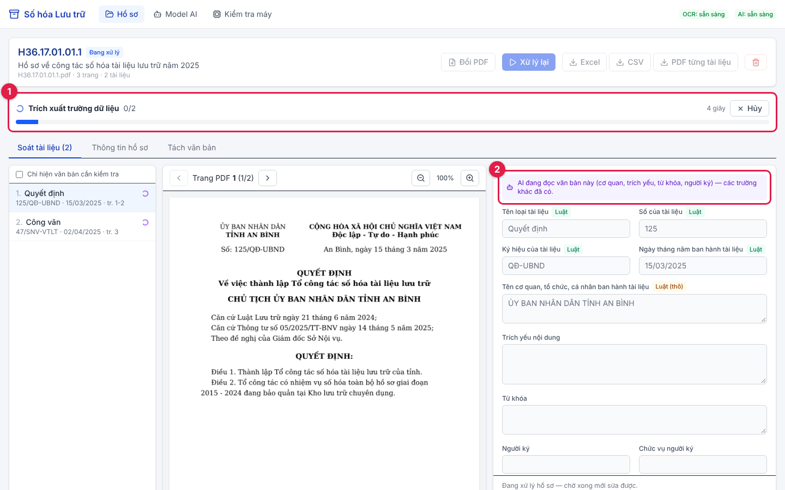

- ① Thanh tiến độ cho biết đang làm gì, còn bao lâu. Bấm **Hủy** nếu muốn dừng.
- Chỉ **vài giây sau**, tên loại, số, ký hiệu, ngày ban hành đã hiện ra.
- ② AI đang đọc tiếp cơ quan ban hành, trích yếu, từ khóa, người ký — mỗi tài liệu khoảng
  **30–60 giây** (máy có card NVIDIA nhanh hơn nhiều).

### Bước 5 — Xem lại và sửa

Khi trạng thái thành **Xong**:

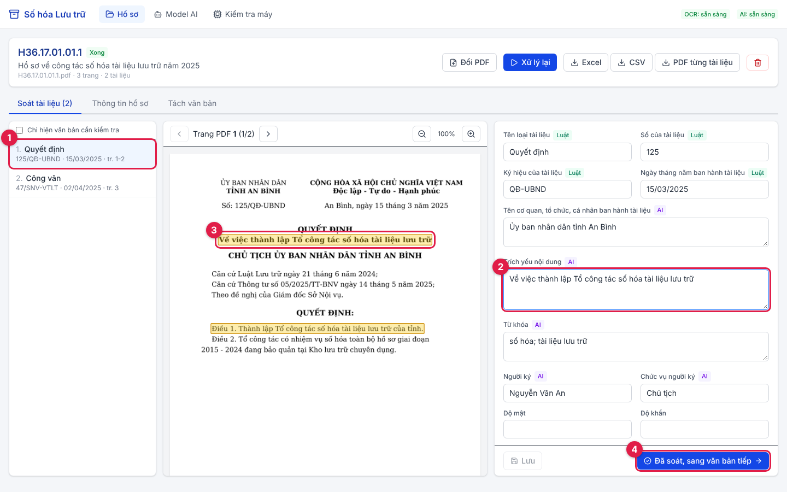

| Số | Ý nghĩa |
|---|---|
| ① | Danh sách tài liệu. Dấu ⚠ = cần kiểm tra, dấu ✓ = đã soát xong |
| ② | Các ô thông tin. **Bấm vào ô nào**… |
| ③ | …thì **chữ tương ứng trên ảnh sáng vàng** để bạn đối chiếu. Dòng viền đỏ nét đứt = chữ mờ, nên xem kỹ |
| ④ | Sửa xong (nếu cần), bấm **Đã soát, sang văn bản tiếp** |

Nhãn nhỏ cạnh tên ô cho biết thông tin lấy từ đâu: **Luật** (đọc theo thể thức văn bản), **AI**,
**Sửa tay**, **Từ hồ sơ**, **Tự tính**. Các ô ít khi cần sửa (mã lưu trữ, số trang…) nằm trong mục
**Thông tin quản lý** ở cuối, bấm để mở.

### Bước 6 — Xuất file

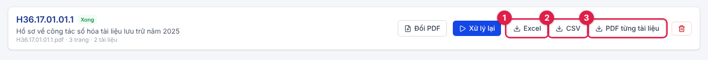

| Số | Nút | Được gì |
|---|---|---|
| ① | **Excel** | File `.xlsx`, mỗi tài liệu một dòng, 23 cột |
| ② | **CSV** | Cùng nội dung, dạng `.csv` (mở được bằng Excel) |
| ③ | **PDF từng tài liệu** | File `.zip` chứa PDF tách riêng của từng tài liệu |

File tải về nằm trong thư mục **Downloads** của máy.

---

## 5. File Excel xuất ra có gì

Mỗi tài liệu là **một dòng**, gồm **23 cột** đúng thứ tự và tên trong Thông tư 05/2025/TT-BNV:

| # | Cột | Lấy từ đâu |
|---|---|---|
| 1 | Mã định danh tài liệu | bạn điền (văn bản giấy thường không có) |
| 2 | Mã lưu trữ tài liệu | tự tạo: mã hồ sơ + số thứ tự |
| 3 | Thời hạn lưu trữ | thông tin chung của hồ sơ |
| 4 | Tên loại tài liệu | **đọc từ văn bản** |
| 5 | Số của tài liệu | **đọc từ văn bản** |
| 6 | Ký hiệu của tài liệu | **đọc từ văn bản** |
| 7 | Ngày tháng năm ban hành tài liệu | **đọc từ văn bản** |
| 8 | Tên cơ quan, tổ chức, cá nhân ban hành tài liệu | **đọc từ văn bản (AI)** |
| 9 | Trích yếu nội dung | **đọc từ văn bản (AI)** |
| 10 | Ngôn ngữ | **đọc từ văn bản** |
| 11 | Số lượng trang | tự đếm |
| 12 | Số lượng tờ (đối với tài liệu số hóa) | tự đếm |
| 13 | Ký hiệu thông tin | thông tin chung của hồ sơ |
| 14 | Từ khóa | **đọc từ văn bản (AI)** |
| 15 | Mức độ tiếp cận | thông tin chung của hồ sơ |
| 16 | Mức độ tin cậy | thông tin chung của hồ sơ (mặc định "Số hóa") |
| 17 | Bút tích (đối với tài liệu số hóa) | bạn điền khi soát |
| 18 | Tình trạng vật lý (đối với tài liệu số hóa) | thông tin chung của hồ sơ (mặc định "Bình thường") |
| 19 | Quy trình xử lý (đối với tài liệu gốc điện tử) | để trống — không áp dụng cho tài liệu số hóa |
| 20 | Chế độ lập tài liệu lưu trữ dự phòng | thông tin chung của hồ sơ |
| 21 | Tình trạng lập tài liệu lưu trữ dự phòng | thông tin chung của hồ sơ |
| 22 | Tệp tin tài liệu | tự tạo: tên file PDF tách riêng |
| 23 | Ghi chú | bạn điền khi soát |

---

## 6. Các việc khác

### Xem lại các hồ sơ đã làm

Bấm **Hồ sơ** ở thanh trên cùng. Bấm vào một dòng ① để mở lại hồ sơ đó.

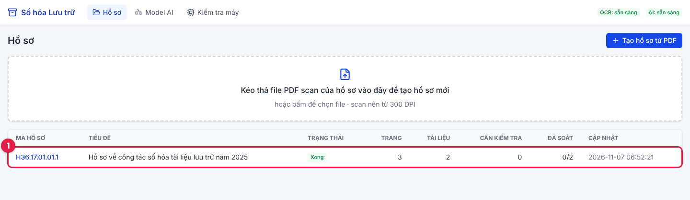

### Sửa thông tin chung của hồ sơ

Trong hồ sơ, mở tab **Thông tin hồ sơ**, sửa rồi bấm **Lưu thông tin** ①. Phần mềm tự cập nhật
xuống mọi tài liệu (trừ ô bạn đã sửa tay).

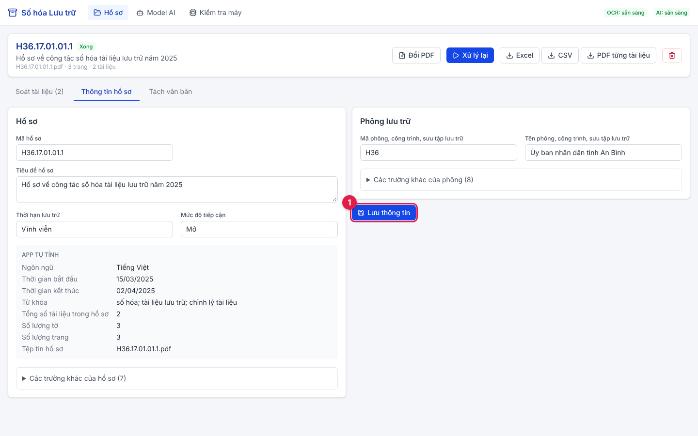

### Tách lại tài liệu

Nếu tách sai: mở tab **Tách văn bản**, bấm lại các trang đầu, rồi bấm **Áp dụng và xử lý lại**.
Những tài liệu không đổi vẫn giữ nguyên phần bạn đã sửa và dấu "đã soát".

### Đổi model AI

Bấm **Model AI** ở thanh trên cùng.

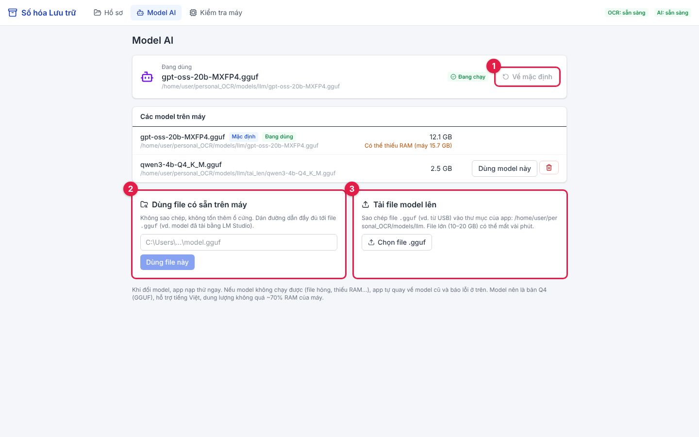

| Số | Dùng khi |
|---|---|
| ① | **Về mặc định** — quay về model `gpt-oss-20b-MXFP4.gguf` |
| ② | **Dùng file có sẵn trên máy** — dán đường dẫn tới file `.gguf` (vd. model tải bằng LM Studio). Không sao chép, không tốn thêm ổ cứng |
| ③ | **Tải file model lên** — chép file `.gguf` (vd. từ USB) vào phần mềm |

Khi đổi, phần mềm nạp thử ngay. Model không chạy được thì phần mềm **tự quay về model cũ** và báo lỗi.

> Cách lấy đường dẫn một file: trong File Explorer, **giữ Shift + bấm chuột phải** vào file →
> **Copy as path**, rồi dán vào ô ②.

### Kiểm tra máy

Bấm **Kiểm tra máy** để xem phần mềm nhận ra máy bạn thế nào (CPU, RAM, card đồ họa) và đang chạy AI
bằng cách nào. Ảnh dưới chụp trên máy thử — máy bạn sẽ hiện thông số khác.

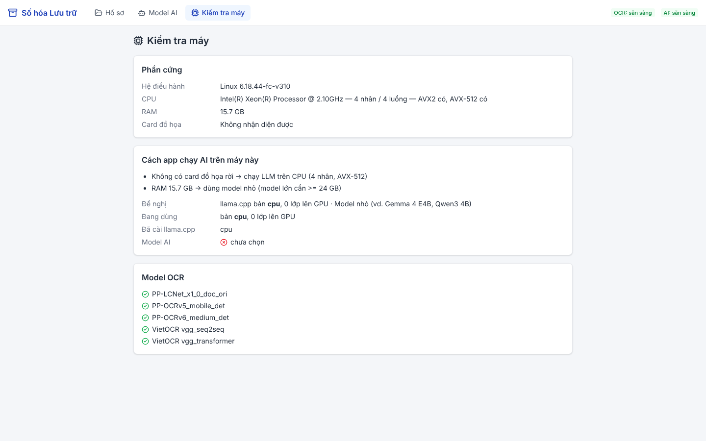

---

## 7. Gặp lỗi thì làm gì

| Hiện tượng | Cách xử lý |
|---|---|
| Chạy **rất chậm** | Cắm sạc. Vào **Settings → System → Power & battery**: tắt **Battery saver**, đặt **Power mode = Best performance**. Tắt bớt phần mềm nặng khác (LM Studio, game…) |
| Góc trên báo **"Mất kết nối backend"** | Cửa sổ đen đã bị đóng → bấm đúp lại `mo-app.bat` |
| Cửa sổ đen báo **address already in use** / **10048** | Phần mềm đang mở sẵn ở một cửa sổ đen khác → dùng cửa sổ đó, hoặc đóng hết rồi mở lại |
| **"AI: lỗi"** ở góc trên | Vào **Model AI** → bấm **Về mặc định**. Vẫn lỗi thì xem dòng lỗi màu đỏ ở trang đó |
| Cảnh báo **"ảnh scan độ phân giải thấp"** | Scan lại tài liệu ở mức **300 DPI** để đọc chính xác hơn |
| Chữ đọc sai nhiều | Kiểm tra bản scan có rõ, thẳng không. Sửa trực tiếp ở màn soát |
| `mo-app.bat` báo **"Chưa cài đặt app"** | Bấm đúp `cai-dat.bat` trước |
| Lỗi khác | Chụp màn hình **cửa sổ đen** + trình duyệt, gửi người hỗ trợ |

### Nếu `cai-dat.bat` báo thiếu Python / Node.js

Máy không có công cụ cài tự động (winget) thì cài tay:

1. **Python 3.12**: vào <https://www.python.org/downloads/windows/> → tải **Windows installer (64-bit)**
   của bản 3.12 → khi cài, **tích ô "Add python.exe to PATH"** → **Install Now**.
2. **Node.js**: vào <https://nodejs.org> → tải bản **LTS** → cài, cứ bấm **Next**.
3. Bấm đúp lại `cai-dat.bat`.

---

## 8. Cập nhật lên bản mới

1. Đóng cửa sổ đen (nếu phần mềm đang mở).
2. Tải ZIP bản mới như [Bước 2.1](#bước-21--tải-phần-mềm-về-máy) và giải nén **đè lên** thư mục cũ
   (chọn **Replace** khi Windows hỏi). Dữ liệu hồ sơ và model **không bị mất** — chúng nằm trong
   thư mục `data` và `models`, bản ZIP không có hai thư mục này.
3. Bấm đúp `cai-dat.bat` (phần nào đã có sẽ được bỏ qua, chỉ mất vài phút).

> Người dùng Git: thay bước 2 bằng `git pull` trong thư mục phần mềm.

---

**Dành cho người phát triển:** kiến trúc, cách chạy từng phần bằng dòng lệnh và quá trình làm ở
[docs/PHAT_TRIEN.md](docs/PHAT_TRIEN.md).
